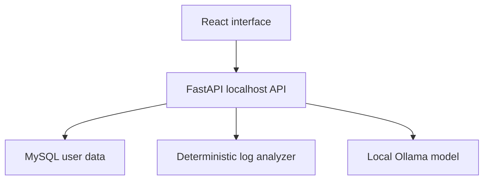

# Sentinel — Local AI Security Assistant

**Version 2.0 · React + FastAPI + MySQL + Ollama · English / தமிழ்**

A local IT security engineering portfolio project. Upload security logs, examine evidence-based findings, ask a real local language model for investigation guidance, save cases, track their status and export incident report drafts.

The full app is in **frontend/** and **backend/**. The earlier single-file demonstration is archived in **legacy/**.

## Features

- Register, sign in and sign out with hashed passwords and expiring sessions.
- Per-user MySQL investigations and chat history.
- UTF-8 text/log/CSV/JSON upload or pasted log analysis (200,000 characters).
- Authentication-failure grouping; success-after-failures correlation by source IP, account and timestamp.
- Sensitive command, blocked traffic and sensitive web-path indicators.
- Real Ollama `/api/chat` integration for optional AI explanations and multi-turn chat.
- English/Tamil interface, translated deterministic findings and language-specific AI prompts.
- Dashboard, search, priority filter and case status updates.
- English/Tamil text report export; browser Print / Save PDF for a selected investigation.
- Backend / database / model health indicators; clear offline/missing-model/timeout errors.

**No API key or paid AI service is required.** Initial downloads require internet and disk space. CPU/GPU inference uses your laptop's resources. The model can be wrong, and Tamil quality varies; manual analyst review is required.

## Windows 11 — start here

Follow **[docs/WINDOWS_SETUP.md](docs/WINDOWS_SETUP.md)** for the complete XAMPP/MySQL walkthrough.

Requirements: **Python 3.11–3.13**, **Node.js 22 LTS**, **Git**, **MySQL 8 or XAMPP MariaDB**, and **Ollama**. Development tested with Python 3.12; no PHP or Laravel required. A 16 GB RAM laptop can try the default 3B model; actual speed and GPU offload depend on drivers and available memory.

```powershell
git clone https://github.com/asrith1999/sentinel-security-assistant.git
cd sentinel-security-assistant
```

Already cloned? Commit/stash your own changes and run `git pull --ff-only` in the existing repository instead.

### 1. Database

Start MySQL in XAMPP. In phpMyAdmin, open **SQL** and run `database/setup.sql` after replacing `CHANGE_ME` with your chosen local password. This creates a dedicated database and user. Tables are created by the backend.

### 2. Backend — terminal 1

```powershell
cd backend
py -3 -m venv .venv
.venv\Scripts\python -m pip install -r requirements.txt
Copy-Item .env.example .env
```

Edit `backend/.env` with your database password. This is mandatory; the placeholder does not configure your actual MySQL credentials.

```powershell
.venv\Scripts\python -m uvicorn app.main:app --host 127.0.0.1 --port 8000
```

API documentation: http://127.0.0.1:8000/docs

### 3. Frontend — terminal 2, from project root

```powershell
cd frontend
npm ci
npm run dev
```

Open **http://127.0.0.1:5173**. The frontend proxies `/api` to the backend; do not serve this version with `python -m http.server`.

### 4. Local AI — install Ollama and download the model

Download Ollama from https://ollama.com/download and start it. In another terminal:

```powershell
ollama pull qwen2.5:3b
ollama list
```

The Ollama desktop app normally serves the API in the background. Use `ollama serve` only if it is not already running. Default API: `http://127.0.0.1:11434`. The configured model is in `backend/.env`; restart FastAPI after changing it.

### 5. Try a complete investigation

1. Register a new local account (no default password/account).
2. Use the **தமிழ் / English** button to select a language.
3. Open **Log analysis → Load sample → Analyze & save**.
4. Expect **8 log lines, 4 findings, High priority** for the built-in example.
5. Click **Generate AI explanation** after the AI health indicator is ready.
6. Open **AI assistant**, enable **Include selected investigation**, and ask a question.
7. Change the case status to **Investigating** and download its report.
8. Open **Investigations** to confirm the saved case persists.

After the first setup, `start-windows.bat` opens both app terminals. Start MySQL and Ollama separately. Close the terminal windows or press Ctrl+C in each to stop the application.

## macOS / Linux

Create the database and edit `backend/.env` as above, then:

```bash
cd backend
python3 -m venv .venv
.venv/bin/python -m pip install -r requirements.txt
cp .env.example .env
# Edit .env before continuing.
cd ../frontend
npm ci
cd ..
sh start-local.sh
```

Start MySQL and Ollama separately. Open http://127.0.0.1:5173.

## Architecture



The browser stores a bearer session token in sessionStorage. The backend stores only its SHA-256 hash; passwords use salted scrypt. Sessions expire after 12 hours by default. There is no external email service, password-reset workflow or administrative dashboard.

## Project structure

```text
frontend/              React components, translations, CSS, Vite config and lockfile
backend/app/           FastAPI routes, authentication, models, rules and Ollama client
backend/tests/         API, authorization, evidence correlation and mocked AI tests
database/setup.sql     MySQL database/user setup
examples/              Synthetic training logs
docs/                  Windows setup, API reference and test notes
legacy/                Earlier rules-only HTML demonstration
```

## Validation

```powershell
cd backend
.venv\Scripts\python -m pip install -r requirements-dev.txt
.venv\Scripts\python -m pytest tests -q
cd ../frontend
npm run build
```

Automated tests use an isolated SQLite database and mocked Ollama HTTP responses. The default application configuration uses MySQL. See **docs/TESTING.md** for exact coverage and remaining laptop acceptance checks. No real AI output is represented by test fixtures.

## Boundaries and limitations

- A localhost learning/portfolio application, not a production SIEM or autonomous SOC.
- No live event collection, host scanning, firewall changes, command execution or automatic containment.
- Rules inspect log text; structured JSON arrays and JSON lines are flattened. CSV is treated as text lines, not a full schema-aware parser. IPv4 correlation is supported; IPv6 and varied vendor formats may not correlate.
- A correlation requires parsed timestamps, a matching account and IP, and five failures in the 15 minutes preceding a success. Timezone-less timestamps are interpreted as UTC. Not every security event is detected.
- AI evidence context is bounded and can omit part of a large log. The original log stays accessible in the investigation. AI output is unverified and never changes deterministic priority.
- The latest 200 investigations and first 100 turns of a chat are displayed. The model receives the latest four turns, plus bounded evidence; it does not have unlimited memory.
- English diagnostics and technical labels may appear in Tamil mode. Tamil UI/findings are translated; generated Tamil accuracy depends on the selected model.
- Logs, chat and AI commentary are stored unencrypted in local MySQL. Use synthetic or appropriately redacted evidence. Keep `.env`, database backups and real logs out of GitHub.
- The app defaults to loopback addresses and rejects unknown Host/Origin headers. It is not configured for public hosting; do not expose it directly to the internet.
- Health checks do not automatically download models, create MySQL accounts or repair database permissions. Restart the backend after fixing initial database setup so tables can be created.
- `frontend/dist` is build output, not a standalone backend. `npm run preview` requires FastAPI to be running and is for local build review only.

The Apache-2.0 project license does not replace dependencies' or model weights' separate licenses. Ollama model reference: https://ollama.com/library/qwen2.5:3b. API reference: https://docs.ollama.com/api/chat.
